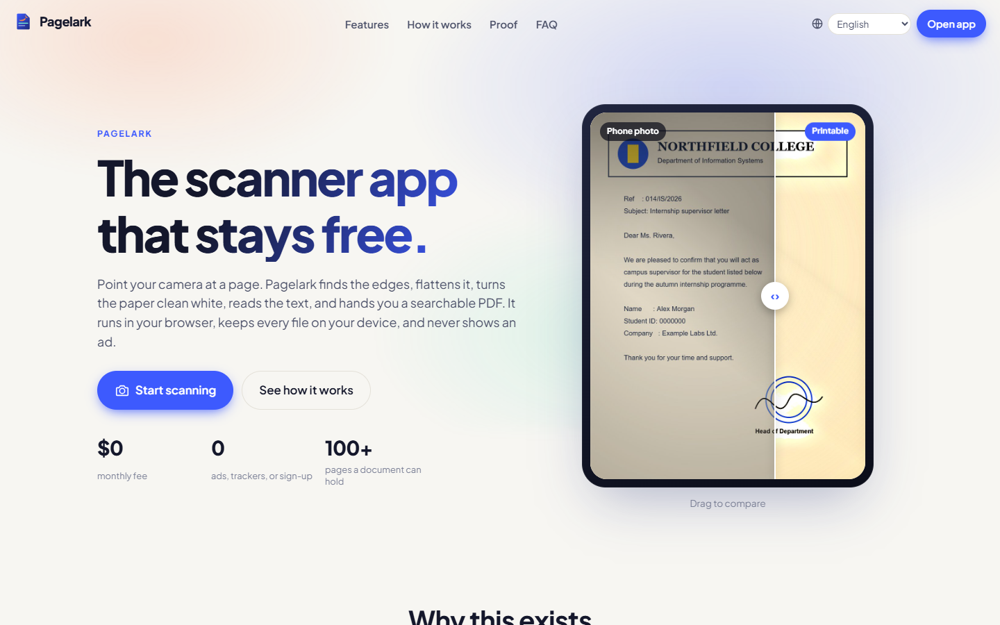
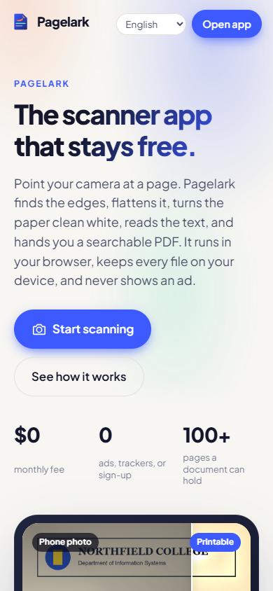
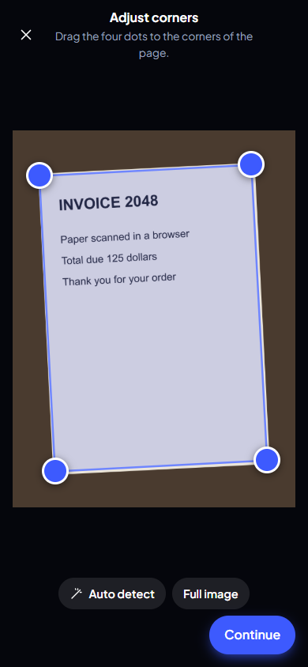
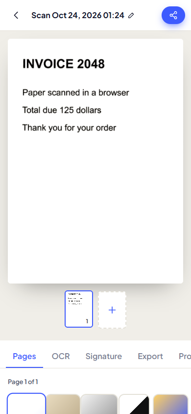
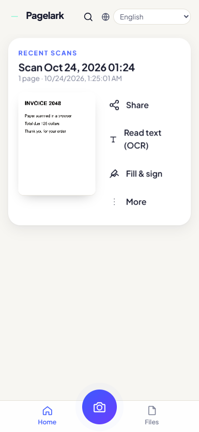
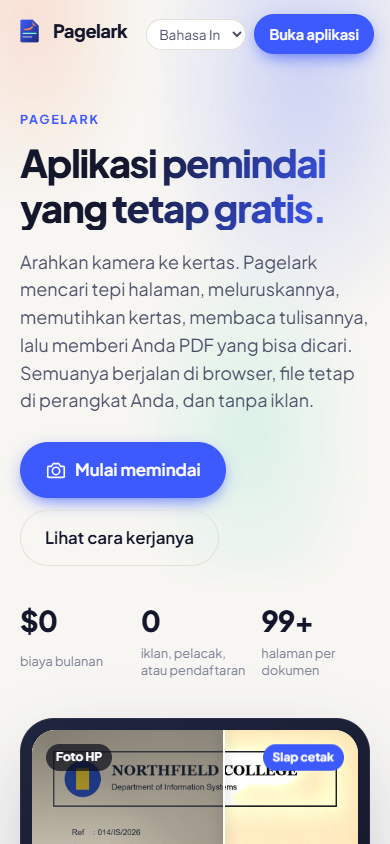
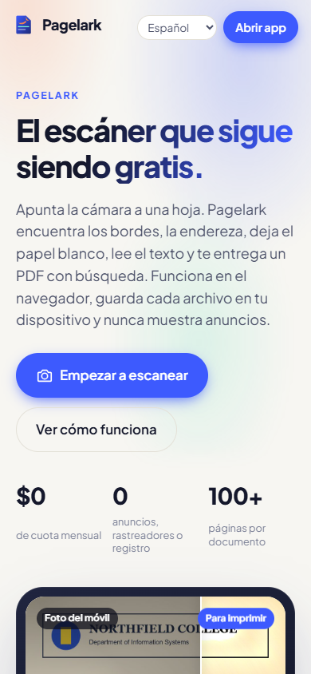
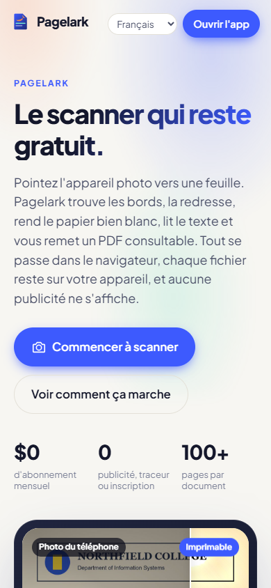
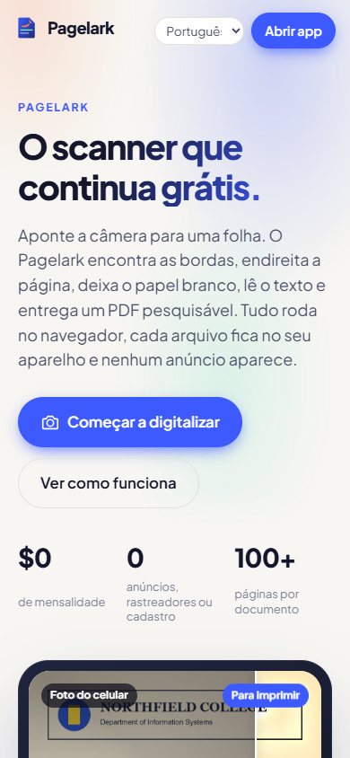
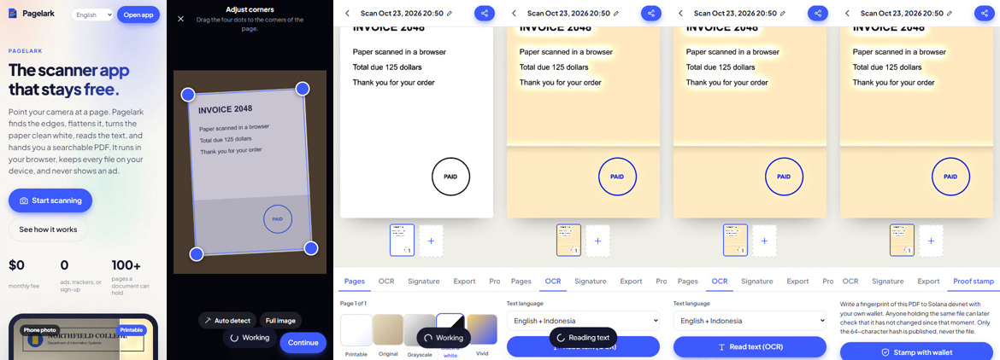

# Pagelark

A free document scanner for phone, tablet and laptop. Point the camera at a page, and Pagelark finds the edges, straightens it, turns the paper clean white, reads the text, and gives you a searchable PDF. There is no account, no ad and no monthly plan, and your files stay on your device.

- Web app: https://bryankwandou.github.io/pagelark/
- Android: debug APK built from this repo (see [Android APK](#android-apk))
- Walkthrough videos: [desktop](docs/media/walkthrough-desktop.mp4) (47 s), [phone](docs/media/walkthrough-phone.mp4) (36 s)



## What it does

| Feature | Where |
| --- | --- |
| Camera capture with five modes (document, whiteboard, book, ID card, business card), torch, gallery import | `src/screens/Camera.tsx` |
| Edge finding and four-corner crop with perspective correction | `src/lib/image.ts` |
| Printable cleanup: removes shadows and paper tint, keeps blue stamps and ink | `src/lib/image.ts` (`applyFilter`) |
| Filters: printable, original, grayscale, black and white, vivid | `src/screens/DocView.tsx` |
| OCR in the browser (tesseract.js), English, Indonesian, Spanish, French, Portuguese, German | `src/lib/ocr.ts` |
| Searchable PDF with an invisible text layer, plus JPG and TXT export, A4 / Letter / fit sizes | `src/lib/pdf.ts` |
| Fill and sign: draw a signature or type text and place it on the page | `src/components/SignPad.tsx` |
| Multi-page documents: add, reorder, rotate, remove, per-page filter | `src/screens/DocView.tsx` |
| Optional proof stamp: SHA-256 of the PDF written to Solana devnet as a memo, checkable at `#/verify` | `src/lib/explorer.ts`, `src/screens/Verify.tsx` |
| Works offline after the first visit (service worker), installable as a PWA | `public/sw.js`, `public/manifest.webmanifest` |
| Interface in English (default), Bahasa Indonesia, Español, Français, Português | `src/lib/i18n.ts`, `src/lib/i18n/` |

## Screens

| Phone landing | Crop | Document | Home |
| --- | --- | --- | --- |
|  |  |  |  |

| Indonesian | Spanish | French | Portuguese |
| --- | --- | --- | --- |
|  |  |  |  |

Phone walkthrough, one frame every 6 seconds (landing, crop, printable filter, filter cycle, OCR, proof tab):



## Run it

```bash
npm install
npm run dev        # http://localhost:5173
npm run build      # type-check and build to dist/
npm run preview    # serve dist/ on :4173
```

## Tests

`scripts/smoke.mjs` drives the built app in Chrome with Playwright. It generates a photo of a tilted page on a desk, then imports, crops, saves, runs OCR, exports a PDF and checks the file.

```bash
npm run build && npm run preview
node scripts/smoke.mjs http://localhost:4173/
node scripts/smoke.mjs https://bryankwandou.github.io/pagelark/
```

Result on 2026-10-24 against the local build:

```
PASS  landing renders on phone  overflow=0px
PASS  landing renders on tablet  overflow=0px
PASS  landing renders on laptop  overflow=0px
PASS  five interface languages switch cleanly
PASS  scan saved as a document
PASS  document screen fits a phone  overflow=0px
PASS  rapid filter taps keep the last choice
PASS  OCR reads the page
PASS  PDF exported  48 KB
PASS  PDF carries a text layer
PASS  document listed on home
PASS  no uncaught page errors
12/12 passed
```

`scripts/walkthrough.mjs` records the two walkthrough videos from the same real flow. Convert them with ffmpeg:

```bash
node scripts/walkthrough.mjs http://localhost:4173/
ffmpeg -i docs/media/walkthrough-phone.webm -c:v libx264 -pix_fmt yuv420p -movflags +faststart docs/media/walkthrough-phone.mp4
```

## Android APK

The APK is a Capacitor 8 shell with the built web app bundled inside, so it works offline and does not load the website. Package `app.pagelark.scanner`, min SDK 24, target SDK 36, permissions `INTERNET` and `CAMERA`.

```bash
npm run apk        # build web, cap sync android, gradlew assembleDebug -> release/pagelark-debug.apk
```

Set `ANDROID_HOME` (or `android/local.properties`) and use JDK 21. The `Android APK` workflow builds the same file on GitHub Actions. Run it by hand, or push a `v*` tag to attach the APK to a release.

## Deployment

Every push to `main` builds and publishes to GitHub Pages (`.github/workflows/pages.yml`). Vite uses `base: './'`, so the same build works under a subpath, inside the APK, and on any static host. CI runs `npm install` instead of `npm ci`, because optional peer dependencies in `@solana/*` and `ws` make `npm ci` reject the lockfile.

## Privacy

Scans live in IndexedDB on the device. Nothing is uploaded. OCR language data is downloaded once from the tesseract.js CDN. The proof stamp publishes only the 64-character hash, signed by your own wallet on devnet.

## Project notes

- `docs/STRATEGY.md`: idea audit, competitor scan and scoring (34/100 raw, 58/100 after revision; the scores are left as they were measured).
- `docs/sources.md`: the sources behind the research.

## License

MIT
